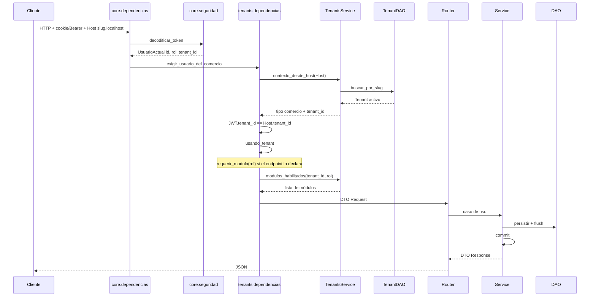
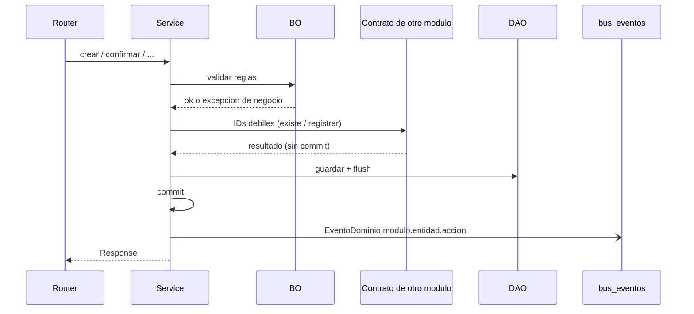

# Flujo transversal — request autenticado

Fuente: `app/core/dependencias.py`, `app/modulos/tenants/dependencias.py`, `app/modulos/ia/dependencias.py`, `app/core/eventos.py`.
Actualizado: 2026-11-12.

Casi todos los endpoints de comercio exigen cookie/Bearer JWT **y** que el Host sea el subdominio del tenant del usuario (`exigir_usuario_del_comercio`). El `tenant_id` se fija en contexto (`usando_tenant`) para filtrar filas sin ForeignKey entre módulos. El JWT se reconstruye solo desde claims (`obtener_usuario_actual`), sin ir a la base.

## Request de un comercio

## Capas dentro de un módulo

## Excepción: webhook n8n

`GET /api/v1/ai/webhook/resumen-dia` no usa JWT. Autentica con `X-Ventas360-Webhook-Secret` y fija el tenant con `X-Tenant-Slug` (`ia.dependencias`). Ver [ia.md](ia.md).

Plataforma (`admin.*` + rol `superadmin`): `exigir_host_plataforma` + `requerir_rol("superadmin")`. Ver [tenants.md](tenants.md).

## Convenciones

- Errores: `RecursoNoEncontrado`, `ReglaDeNegocioViolada`, `NoAutenticado`, `NoAutorizado` → `{"error": {"codigo", "mensaje"}}`.
- Contratos **no hacen commit**; el service orquestador cierra la transacción.
- El bus es en memoria; un fallo en un manejador no revierte el commit.
- Suscripciones registradas hoy: solo `ventas.remito.confirmado` y `ventas.factura.creada` (hooks locales no-op).
