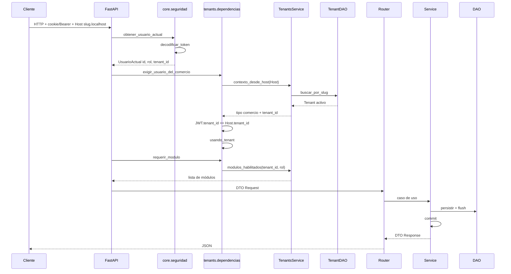
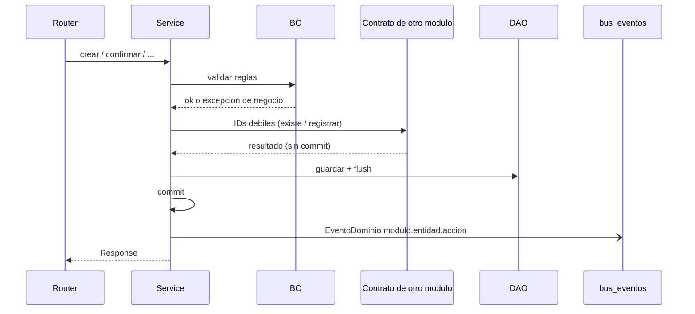

# Flujo transversal — request autenticado

Fuente: `app/core/dependencias.py`, `app/modulos/tenants/dependencias.py`, `app/modulos/ia/dependencias.py`, `app/core/eventos.py`.
Actualizado: 2026-11-10.

Casi todos los endpoints de comercio exigen cookie/Bearer JWT **y** que el Host sea el subdominio del tenant del usuario. El `tenant_id` se fija en contexto (`usando_tenant`) para filtrar filas sin ForeignKey entre módulos.

Dependencias típicas de un endpoint de comercio: `obtener_usuario_actual` (JWT) → `exigir_usuario_del_comercio` (Host + match de tenant) → `requerir_modulo(rol)`.

## Request de un comercio

## Capas dentro de un módulo

## Excepciones al JWT de comercio

No todos los endpoints pasan por `exigir_usuario_del_comercio` + `requerir_modulo`:

| Caso | Auth |
|------|------|
| `POST /auth/login`, `POST /auth/logout` | sin JWT (logout solo borra cookie) |
| `GET /auth/me` | JWT (`obtener_usuario_actual`) + Host; no exige módulo |
| `GET /tenants/contexto` | público (Host) |
| `GET/PUT /preferencias` | JWT de comercio **sin** `requerir_modulo` |
| CRUD `/tenants` (salvo contexto y permisos) | host `admin.*` + rol `superadmin` |
| `GET /ai/webhook/resumen-dia` | `X-Ventas360-Webhook-Secret` + `X-Tenant-Slug` (sin JWT). Ver [ia.md](ia.md) |

## Convenciones

- Errores: `RecursoNoEncontrado`, `ReglaDeNegocioViolada`, `NoAutenticado`, `NoAutorizado` → `{"error": {"codigo", "mensaje"}}`.
- Contratos **no hacen commit**; el service orquestador cierra la transacción.
- El bus es en memoria; un fallo en un manejador no revierte el commit.
