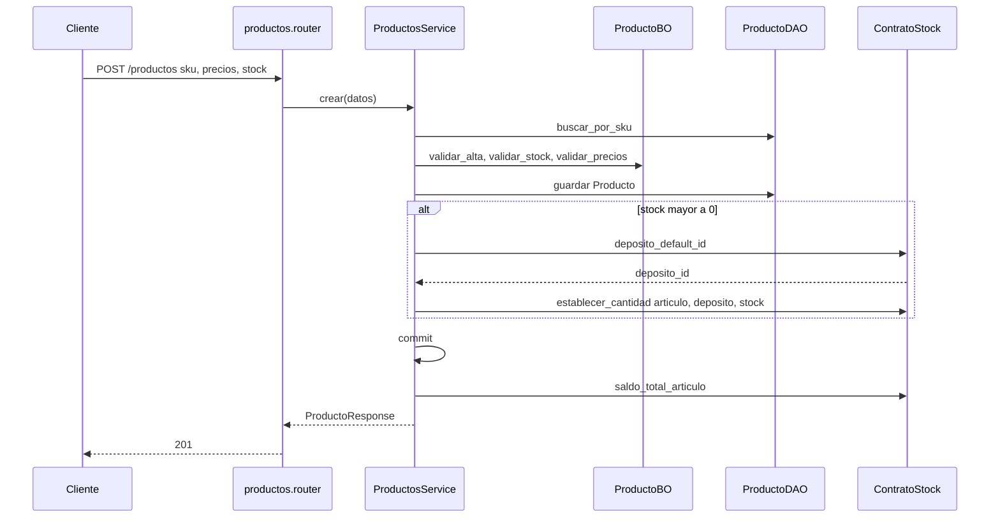

# productos — alta

Fuente: `app/modulos/productos/` · Flujo principal: `POST /api/v1/productos`.
Actualizado: 2026-11-13.

SKU único. Si `stock > 0`, sincroniza el saldo del depósito default vía contrato (misma TX). El `stock` del response se lee siempre de `ContratoStock.saldo_total_articulo`. Escritura: módulo `articulos`. Lectura también desde `mostrador` y `cta_cte`.

## Otros endpoints

| Método | Ruta | operation_id |
|--------|------|----------------|
| GET | `/productos` | `listar_productos` (paginado; query `q`, `activo`; stock vía contrato) |
| GET | `/productos/{id}` | `obtener_producto` |
| PUT | `/productos/{id}` | `actualizar_producto` (si cambia `stock`, re-sincroniza depósito default) |

## Contrato público

`ContratoProductos`: `obtener_producto`, `obtener_por_sku`, `obtener_por_codigo_barras`, `obtener_por_codigo_proveedor`, `buscar_por_texto`, `listar_activos`, `contar_activos`, `contar_bajo_stock`, `listar_bajo_stock`, `stock_total`, `establecer_stock`, `aplicar_costo_lista`, `crear_desde_proveedor`, `upsert_desde_lista`. Usado por **ventas**, **compras**, **precios**, **stock**, **proveedores**, **reporteria**, **ia**.
